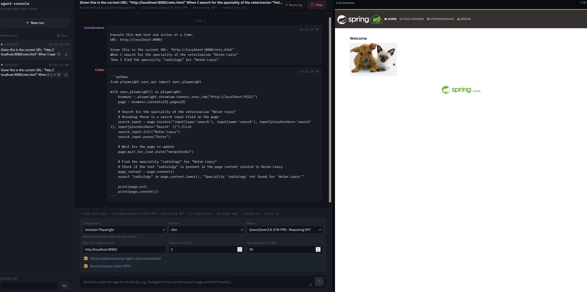

# Online Appendix: Exploring LLM Agents for Autonomous Web Application Testing

This repository is the online appendix for the paper
**"Exploring LLM Agents for Autonomous Web Application Testing."** It contains
the source code of the autonomous web testing demonstrator used in the study
and the detailed, per-run results of all experiments.



*The Demonstrator UI: the task list on the left and the agent chat view and the live browser feed on the right.*

## Abstract

Automated web application testing traditionally relies on scripts tightly
coupled to specific UI elements and workflows, making them brittle and costly
to maintain. Large Language Models (LLMs) offer an alternative by interpreting
natural-language test goals and autonomously interacting with web
applications. Building on our previous four-agent AutoGen approach, we
investigate two adaptations using the *browser-use* framework, differing in
their information-sharing strategies, and compare them with a single-agent
configuration that directly executes Gherkin test scenarios. We evaluate the
configurations on 15 scenarios for the open-source PetClinic application and
compare them against the original AutoGen approach, re-evaluated using the
same model. All configurations execute simple scenarios reliably, but
performance decreases on complex and negative scenarios. The single-agent
*browser-use* configuration achieves the highest success rate, while both
four-agent *browser-use* configurations incur substantially higher token
consumption without improving reliability over the *AutoGen* baseline. Our
findings highlight persistent challenges in reliably executing complex
workflows and handling invalid test inputs.

## Repository structure

```text
.
├── Demonstrator-Tool/   Source code of the autonomous web testing demonstrator
├── Scenarios/           The 15 Gherkin test scenarios used in the evaluation
├── Results/             Detailed per-run results of all experiments
├── doc/                 Figures (e.g. screenshot of the Demonstrator UI)
└── results-table.md     Aggregated results (per-scenario and overall)
```

- **`Demonstrator-Tool/`** — the demonstrator implementation: a FastAPI
  backend that runs and observes the browser-testing tasks, a React/Vite
  frontend for submitting tasks and watching the agent event stream live, and
  the `browser-use`/Chromium browser automation. See
  [Demonstrator-Tool/README.md](Demonstrator-Tool/README.md) for setup and
  usage.

- **`Scenarios/`** — the 15 Gherkin test scenarios evaluated in the paper,
  grouped by category:
  - [simple-scenarios.md](Scenarios/simple-scenarios.md) — `S1`–`S9`
  - [complex-scenarios.md](Scenarios/complex-scenarios.md) — `C10`–`C12`
  - [negative-scenarios.md](Scenarios/negative-scenarios.md) — `N13`–`N15`

- **`Results/`** — the raw results of every run, organized by scenario and
  agent configuration (see below).

- **[`results-table.md`](results-table.md)** — the aggregated results: the
  per-scenario table, category and overall aggregates, and the hallucination
  analysis that underlie the main results table in the paper.

## System under test

The scenarios target the open-source
[PetClinic](https://spring-petclinic.github.io/) application, a web
application for managing pet owners, their pets, and veterinary visits. In the
experiments it was deployed from the Docker image
`jbrisbin/spring-petclinic` and served at `http://localhost:8080`, which is
the base URL referenced by all scenarios. To run it locally:

```bash
docker run -d -p 8080:8080 jbrisbin/spring-petclinic
```

## Results directory

The `Results/` directory contains the detailed output of all experiment runs.
It is organized in three levels: **scenario → configuration → run**.

### Scenarios

Each top-level folder is one of the 15 Gherkin test scenarios evaluated in the
paper, grouped by category:

| Folder | Category | Description |
| ------ | -------- | ----------- |
| `S1` – `S9` | Simple | Single-step or short, straightforward scenarios. |
| `C10` – `C12` | Complex | Multi-step scenarios with longer workflows. |
| `N13` – `N15` | Negative | Scenarios with invalid inputs where the expected behavior is for the agent to stop and report failure. |

The full text of each scenario is available in the [`Scenarios/`](Scenarios/) directory.

### Configurations

Each scenario folder contains one subfolder per agent configuration:

| Folder | Configuration |
| ------ | ------------- |
| `bo` | Browser Only — a single `browser-use` agent. |
| `sh` | Four Agent (shared history) — analyst, coordinator, browser, and observer agents sharing a conversation history. |
| `sb` | Four Agent (state-based) — the same four roles using state-based prompts. |
| `ag` | AutoGen Playwright — the original four-agent AutoGen baseline, re-run with the same model. |

### Runs

Each configuration folder contains one or more runs (task executions), each
identified by a task ID. For every run there is:

- **`<task-id>.json`** — the full task record: the configuration, provider,
  and model used, the task text, the final status, statistics (iterations,
  LLM calls, and token usage per agent), and the complete event trace of the
  run.
- **`<task-id>/`** — the run's media assets:
  - `screenshots/` — a screenshot for each executed step.
  - `video/recording.mp4` — a video recording of the browser session.

These artifacts are the basis for the manual evaluation described in the
paper: the recorded video, per-step screenshots, and action trace were used to
judge whether each run was actually correct, independent of the success or
failure the agent reported.

### Viewing the results in the Demonstrator

The results can be replayed in the Demonstrator tool. The backend loads every
task record it finds in `backend/tasks/` on startup, so to view a run:

1. Copy the run's `<task-id>.json` file **and** the `<task-id>/` directory
   (containing `screenshots/` and `video/`) into
   `Demonstrator-Tool/backend/tasks/`.
2. Start the tool (see [Demonstrator-Tool/README.md](Demonstrator-Tool/README.md)).

The run then appears in the task list, and you can open its full event
transcript, step screenshots, and video recording exactly as during the
original execution.
