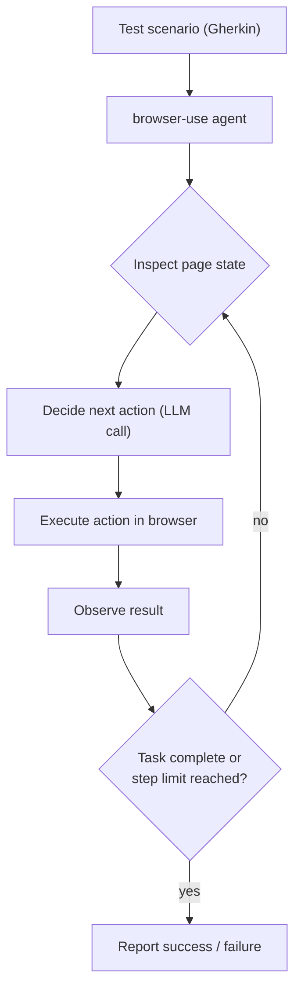
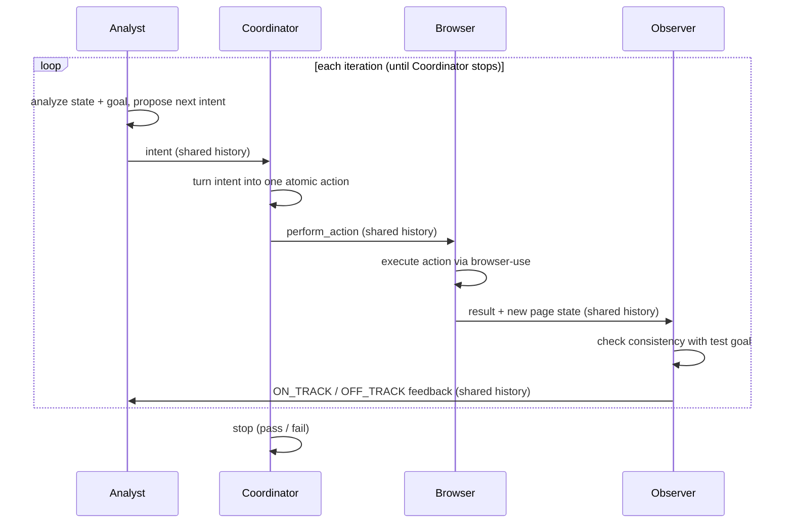
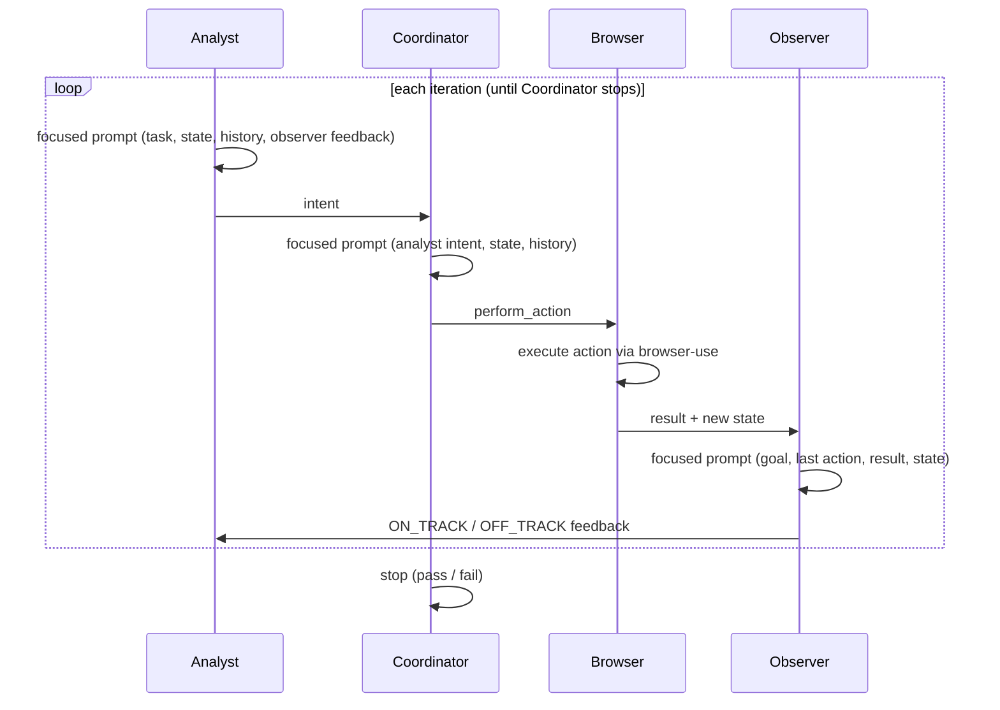
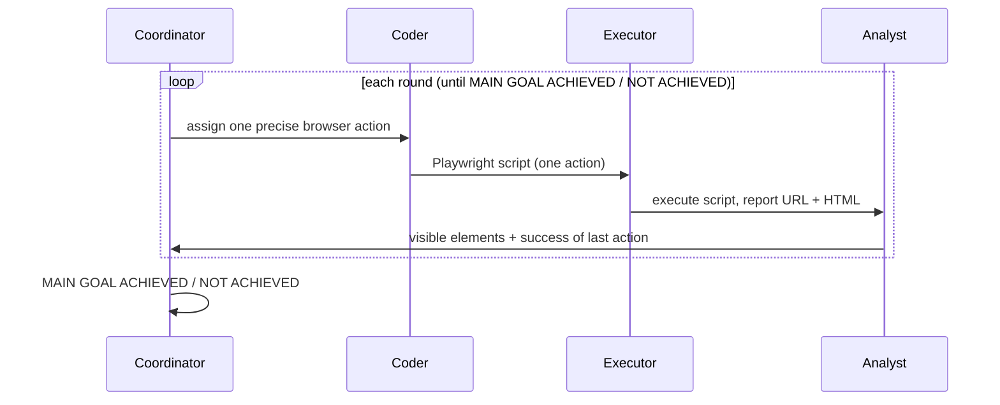

# Agent Configurations

This document describes the four agent configurations evaluated in the paper
in detail: the roles each configuration uses, the prompts given to the
individual agents, and how the conversation flows between them. The prompts
shown below are the exact system prompts used by the demonstrator (see
[`Demonstrator-Tool/backend/agents/`](Demonstrator-Tool/backend/agents/)).

All configurations receive the same input: a Gherkin test scenario and the
base URL of the system under test. They differ in how many agents are involved,
how those agents are specialized, and how information is shared between them.

| Configuration | Agents | Information sharing | Browser interaction |
| ------------- | ------ | ------------------- | ------------------- |
| **Browser Only** (`bo`) | 1 | n/a (single agent) | `browser-use` directly |
| **Four Agent (Shared History)** (`sh`) | 4 | one shared conversation history | `browser-use` |
| **Four Agent (State-Based)** (`sb`) | 4 | focused per-agent state prompts | `browser-use` |
| **AutoGen Playwright** (`ag`) | 4 | AutoGen group chat | generated Playwright scripts |

---

## 1. Browser Only (`bo`)

A single autonomous agent receives the complete test scenario and performs all
planning and browser interaction independently. There is no separate
planning, coordination, or observation step — the agent is a
[`browser-use`](https://browser-use.com/) agent that iterates on its own.

The agent is given the test scenario as its task:

```text
Execute the following test case in Gherkin syntax on the provided web application:
{task}

Please execute it to the best of your abilities.
```

Internally, the agent is wrapped so that it only performs the given task and
returns control of the browser when it is done:

```text
Only perform the task you are given.

TASK: {task}

After you are done with this task you can stop and give up control of the browser.
Do not perform any tasks beyond what you where asked to do.
```

The `browser-use` agent then runs its own internal loop: at each step it
inspects the current page state, decides on an action, executes it, and
observes the result, repeating until it judges the task complete or the step
limit is reached. Each of these internal steps is itself an LLM call, which is
why this configuration still makes multiple LLM calls per run even though it
has only one agent.



---

## 2. Four Agent (Shared History) (`sh`)

Four specialized agents collaborate using a **single shared conversation
history**. Every agent sees the full transcript of the conversation so far.
The agents run in a fixed order each iteration:

1. **Analyst** — decides the next high-level test intent.
2. **Coordinator** — turns that intent into exactly one atomic browser action.
3. **Browser** — executes the action via `browser-use`.
4. **Observer** — checks whether the execution is still consistent with the test goal.

Only the **Coordinator** is authorized to stop the loop (by calling `stop`).

### Roles and prompts

**Analyst**

```text
You are the Analyst agent in a multi-agent web testing system.

Your responsibility is to analyze the current web application state and the overall test goal, and decide what the next step in the test should be.

Rules:
- Focus on reasoning about test progress and identifying the next logical intent.
- Base your analysis strictly on the provided page state and test description.
- If the state is ambiguous or missing information, explicitly say what is unclear.
- You may call tools if provided to get more context about the web application's current state.
- Call tools ONLY if the state is ambiguous. Do not re-verify after initial check.
- For forms please provide all inputs for the next action at once.
- If for some forms not all inputs are given in the task description you may randomly generate inputs that make sense.
- Do never change the given values, but you may adjust the randomly generate inputs if they do not work.

Output format (always):
1. Current test objective:
2. Observed state summary:
3. Next action to perform:
```

**Coordinator**

```text
You are the Coordinator agent in a multi-agent web testing system.

Your responsibility is to convert the Analyst's high-level intent into a single precise executable UI action using the available tools.

Rules:
- You MUST produce exactly one atomic action per turn. To fill forms you should pass all available inputs in one action.
- You MUST give all the concrete inputs to fill form with.
- The action must be directly grounded in the current page state (visible elements only).
- If multiple elements have the same label or other identifiers, be specific about which one you mean, for instance by passing their Index.
- Do NOT guess element names or IDs—only use selectors or labels that appear in the given state.
- Do NOT perform analysis of the whole test plan; only focus on the next action.
- You may call other tools if provided to get more context.
- For your decision call tools `perform_action` (to execute ONE browser action) or `stop` (if the task is complete or cannot proceed).
- You should try to complete the task and only stop when you are sure the task was completed or all possible actions to try to complete the task have been exhausted.
- Use the current page-state provided to you, to identify elements and indizes.
```

**Browser** — a `browser-use` agent that executes the coordinator's action. It
is given a focused task prompt (see the Browser Only section) and is limited to
a small number of internal steps per iteration.

**Observer**

```text
You are the Observer agent in a multi-agent web testing system.

Your responsibility is to monitor whether the test execution is still consistent with the intended test scenario.

Rules:
- Do NOT suggest new actions or interact with tools.
- Evaluate the latest state against the overall test goal and expected progress.
- Detect deviations such as wrong page, missing elements, unexpected popups, or failed transitions.
- If execution is correct, confirm briefly.
- If execution is off track, clearly describe the issue and what needs to be corrected at a high level.

Output format (always):
Status: ON_TRACK or OFF_TRACK
Reason:
Expected vs Observed:
Recommended adjustment (high-level only):

Example output:
Status: OFF_TRACK
Reason: Login failed; still on login page with error message.
Expected vs Observed: Expected dashboard, observed invalid password alert.
Recommended adjustment: Re-attempt login with correct credentials.
```

### Conversation flow

All four agents append to and read from the same conversation history, so each
agent's decision is grounded in everything the previous agents said.



---

## 3. Four Agent (State-Based) (`sb`)

This configuration uses the **same four roles** as the shared-history
configuration, but replaces the shared conversation history with **focused,
per-agent prompts**. Instead of reading the full transcript, each agent is
given only the specific pieces of state it needs for its decision. This is
motivated by the assumption that access to the complete conversation history
can introduce irrelevant context and distract agents from their specific
responsibilities.

The role prompts are the same as in the shared-history configuration, with two
notable differences:

- The **Analyst** prompt adds explicit guidance about failing the test when it
  cannot be finished:

  ```text
  The goal is to test the application not to complete the task by any means, so if a test cannot be finished it should be failed.
  ...
  - If the test was executed completely the next action to perform should be to stop with the fitting verdict.
  - If the test failed the execution should be stopped with the appropriate verdict and reason.
  - If you have tried to finish the test multiple times already, but cannot succeed the next action should be to fail the test.
  ```

- Each agent's **task prompt** is built from a focused template rather than the
  shared history.

### Focused task prompts

**Analyst** receives the task, the current state, the action history, the last
tool calls, and the most recent observer feedback:

```text
User task description:
{user_message}

Current state (url and simplified DOM):
{state}

Previous actions taken:
{action_history}

Last tool calls:
{last_tool_calls}

{observer_feedback}

Please provide your analysis of the current test progress and decide the next high-level action.

Output format:
1. Current test objective:
2. Observed state summary:
3. Next action to perform:
```

**Coordinator** receives the analyst's intent, the current state, and the
action history:

```text
Analyst intent:
{analyst_message}

Current state (url and simplified DOM):
{state}

Action history:
{action_history}

Last tool calls:
{last_tool_calls}

Based on the analyst's intent and current state, produce **exactly one atomic browser action**.
Call tool `perform_action` to perform an action or tool `stop` when the test execution is finished accordingly.
```

**Observer** receives the original test goal, the most recent action, the
result of the last browser execution, and the current state:

```text
Original test goal:
{test_goal}

Most recent action taken:
{last_action}

Result of the last browser execution:
{browser_result}

Current state (url and simplified DOM) after the most recent action was performed:
{state}

Evaluate whether the latest execution is consistent with the original test goal.
Use the test goal as the source of expected behavior; do not infer requirements
from another agent's analysis or recommendations.
Output format (always):
Status: ON_TRACK or OFF_TRACK
Reason:
Expected vs Observed:
Recommended adjustment (high-level only):
```

### Conversation flow

The agent order is the same as in the shared-history configuration, but each
agent is handed a focused prompt containing only the state it needs rather than
the full conversation.



---

## 4. AutoGen Playwright (`ag`)

This is the baseline from our previous work, re-evaluated with the same model.
It uses four agents in an **AutoGen group chat** with a fixed speaker rotation:

1. **Coordinator** — assigns one precise browser action at a time.
2. **Coder** — writes a single Python Playwright script for that action.
3. **Executor** — runs the script and reports the result.
4. **Analyst** — inspects the result and HTML, reporting visible elements and
   whether the previous action succeeded.

Unlike the `browser-use` configurations, these agents do not drive the browser
directly. Instead, the Coder generates a Playwright script that connects to the
runner-owned Chromium instance over CDP and performs exactly one action. The
loop continues until the Coordinator writes `MAIN GOAL ACHIEVED` or
`MAIN GOAL NOT ACHIEVED`.

### Roles and prompts

**Coordinator**

```text
You are the Coordinator. Achieve this complete test:
{task}
The starting URL is {base_url}.
Assign one precise browser action at a time. When every requirement is satisfied,
write MAIN GOAL ACHIEVED. If it cannot be completed, write MAIN GOAL NOT ACHIEVED.
```

**Coder**

```text
You are the Coder. Write exactly one complete Python Playwright script for the Executor.
Connect to the existing Chromium browser with:
from playwright.sync_api import sync_playwright
with sync_playwright() as playwright:
    browser = playwright.chromium.connect_over_cdp("http://localhost:{port}/")
    page = browser.contexts[0].pages[0]
Only perform the single action requested by the Coordinator, then print the page URL and HTML.
Do not use page.goto(), hidden elements, or multiple actions across navigation.
```

**Executor**

```text
Execute the Coder's Playwright script and report its result.
```

**Analyst**

```text
You are the Analyst. Inspect the Executor result and HTML. Report precise visible
interaction elements and whether the previous action succeeded. Do not perform browser actions.
```

### Conversation flow

The speaker order is fixed (Coordinator → Coder → Executor → Analyst) and
repeats until the Coordinator signals that the goal has been achieved or cannot
be achieved.



---

## Summary of differences

- **Browser Only** is the simplest: one `browser-use` agent does everything. It
  makes the fewest outer-loop LLM calls but relies entirely on the agent's own
  internal loop.
- **Four Agent (Shared History)** splits the work across four specialized
  agents that all see the full conversation. This provides oversight (the
  Observer) and a clear plan/execute separation, at the cost of a longer shared
  context.
- **Four Agent (State-Based)** keeps the same four roles but gives each agent a
  focused prompt with only the state it needs, aiming to reduce distraction
  from irrelevant context.
- **AutoGen Playwright** is the previous approach: instead of driving the
  browser directly, the agents generate and execute Playwright scripts, which
  introduces code generation and debugging as additional failure modes.
